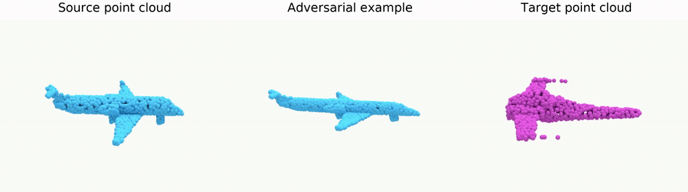
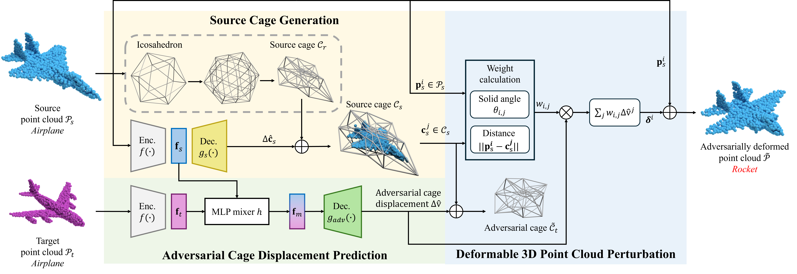

<div align="center">

<h1>Deformable 3D Point Cloud Perturbations<br>using Cage-based Deformation for Semantic Consistency</h1>

<p><b>Kyo Seok Lee and Hak Gu Kim</b><br>Chung-Ang University</p>
<p><b>IEEE Transactions on Information Forensics and Security (T-IFS), 2026</b></p>

<p>
  <a href="https://ieeexplore.ieee.org/document/11534487"></a>
  <a href="https://irislab.cau.ac.kr/Deformable-3D-ADV/"></a>
</p>

</div>

<h2 align="center">Results</h2>

<p align="center"></p>

<p align="center">
  <a href="https://irislab.cau.ac.kr/Deformable-3D-ADV/">
    
  </a>
</p>
<p align="center"><sub>Source point cloud · Adversarial example · Target point cloud</sub></p>

The deformed airplane remains visually recognizable but is misclassified as a rocket.

---

<h2 align="center">Method</h2>

<p align="center">
  
</p>

We refine a source cage, predict adversarial cage displacements from source–target features, and deform the point cloud using mean value coordinates.

---

## Installation

Requires Linux, an NVIDIA GPU and a CUDA development toolkit (`nvcc`).

```bash
git clone https://github.com/kslee990614/Deformable-3-D-Point-Cloud-Perturbations-Using-Cage-Based-Deformation-for-Semantic-Consistency.git Deformable-3D-ADV
cd Deformable-3D-ADV
conda create -n deformable3d python=3.7 -y
conda activate deformable3d
conda install pytorch=1.10.0 torchvision=0.11.0 cudatoolkit=11.3 -c pytorch -y
conda install faiss-gpu -c pytorch -y
python -m pip install "pip<24.1" "setuptools<68" wheel ninja
python -m pip install -r requirements.txt
python -m pip install --no-build-isolation -e ./pytorch_points
```

If PyMesh installation fails, follow its [installation guide](https://pymesh.readthedocs.io/en/latest/installation.html). GPU execution has not been verified in this release.

## Data preparation

Download [ShapeNet-Part](https://www.shapenet.org/), [ModelNet40](https://modelnet.cs.princeton.edu/download.html), or [ScanObjectNN](https://hkust-vgd.github.io/scanobjectnn/). Preserve the official train/test splits.

```bash
# ShapeNet-Part: point folders with split JSONs
python prepare_data.py --dataset SHAPENET --input_dir raw/shapenetpart --output data/shapenet --sampling fps

# ModelNet40: NPZ containing train_pc/train_label and test_pc/test_label
python prepare_data.py --dataset MN40 --input_npz raw/modelnet40.npz --output data/mn40 --sampling fps

# ScanObjectNN: object-only HDF5 with data/label keys
python prepare_data.py --dataset SCANOBJECTNN --train_h5 raw/training_objectdataset.h5 --test_h5 raw/test_objectdataset.h5 --class_names raw/scanobjectnn_classes.json --output data/scanobjectnn --sampling fps
```

The script creates 1,024-point XYZ TXT files, category folders and split JSONs. ScanObjectNN class names must follow the victim's label order. Raw meshes must first be sampled into point clouds. Normalization defaults to `none`; match preprocessing to the checkpoints.

| Dataset | `--dataset` | `--data_dir` | Classes |
| --- | --- | --- | --- |
| ShapeNet-Part | `SHAPENET` | `data/shapenet` | 16 |
| ModelNet40 | `MN40` | `data/mn40` | 40 |
| ScanObjectNN | `SCANOBJECTNN` | `data/scanobjectnn` | 15 |

## Training

Example: ScanObjectNN / PointNet / Bag. Stage-one settings are illustrative; stage two uses the supplied Bag recipe. Pretrained victim weights are required separately and are not included.

### Shape deformation

```bash
python cage_deformer_3d.py --dataset SCANOBJECTNN --data_dir data/scanobjectnn --class_names data/scanobjectnn/class_names.json \
  --data_cat bag --phase train --batch_size 32 --nepochs 50 --num_point 1024 --bottleneck_size 256 --n_fold 2 --loss CD \
  --name scanobjectnn_bag --loss_weight 1 --mvc_weight 1 --sym_weight 0 --p2f_weight 0.1 --snormal_weight 0.1 --full_net --log_dir log/scanobjectnn/stage1
```

### Adversarial decoder

Set `--ckpt` to the stage-one `net_final.pth` saved in the timestamped run folder.

```bash
python cage_deformer_3d.py --dataset SCANOBJECTNN --data_dir data/scanobjectnn --class_names data/scanobjectnn/class_names.json \
  --data_cat bag --phase adv_train --batch_size 32 --nepochs 347 --num_point 1024 --bottleneck_size 256 --n_fold 2 --loss CD \
  --name scanobjectnn_bag --loss_weight 1 --mvc_weight 1 --sym_weight 0 --p2f_weight 0 --snormal_weight 0 --full_net \
  --ckpt checkpoints/scanobjectnn/stage1/bag/net_final.pth --classifier pointnet --classifier_ckpt checkpoints/scanobjectnn/victims/pointnet.pth --log_dir log/scanobjectnn/stage2
```

## Evaluation

Set `--ckpt` to the trained stage-two checkpoint. Use matching dataset, category and victim weights.

```bash
python cage_deformer_3d.py --dataset SCANOBJECTNN --data_dir data/scanobjectnn --class_names data/scanobjectnn/class_names.json \
  --data_cat bag --phase adv_test --batch_size 1 --num_point 1024 --bottleneck_size 256 --n_fold 2 --loss CD --full_net --data_max -1 \
  --ckpt checkpoints/scanobjectnn/stage2/bag/net_final.pth --classifier pointnet --classifier_ckpt checkpoints/scanobjectnn/victims/pointnet.pth --log_dir log/scanobjectnn/eval/bag
```

## Citation

```bibtex
@article{lee2026deformable,
  title={Deformable 3D Point Cloud Perturbations using Cage-based Deformation for Semantic Consistency},
  author={Lee, Kyo Seok and Kim, Hak Gu},
  journal={IEEE Transactions on Information Forensics and Security},
  year={2026},
  publisher={IEEE},
  url={https://ieeexplore.ieee.org/document/11534487}
}
```

This repository is based on [yifita/deep_cage](https://github.com/yifita/deep_cage).
